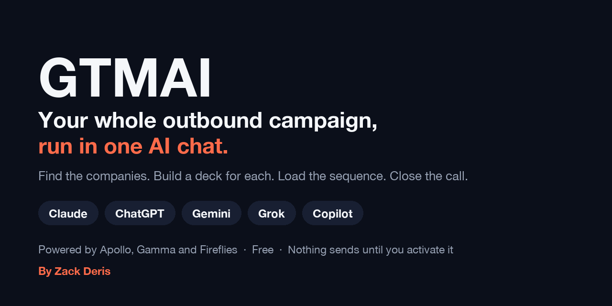
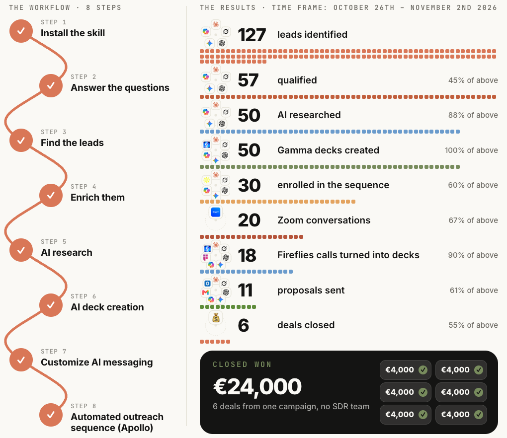
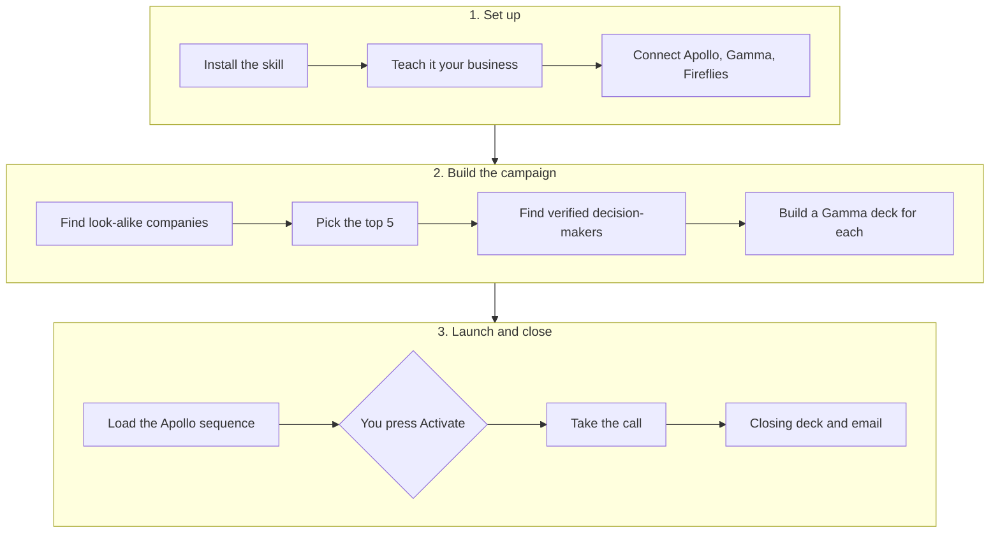
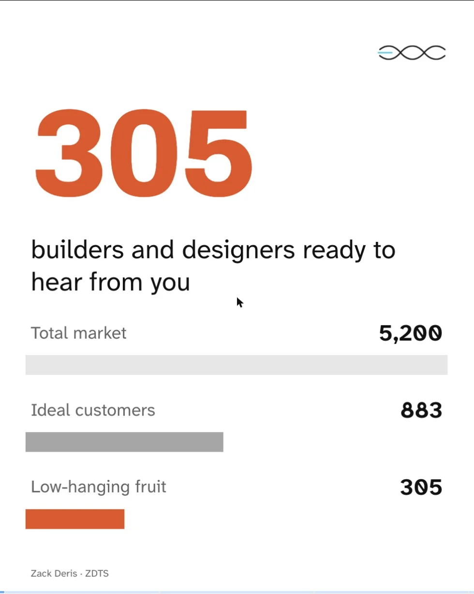
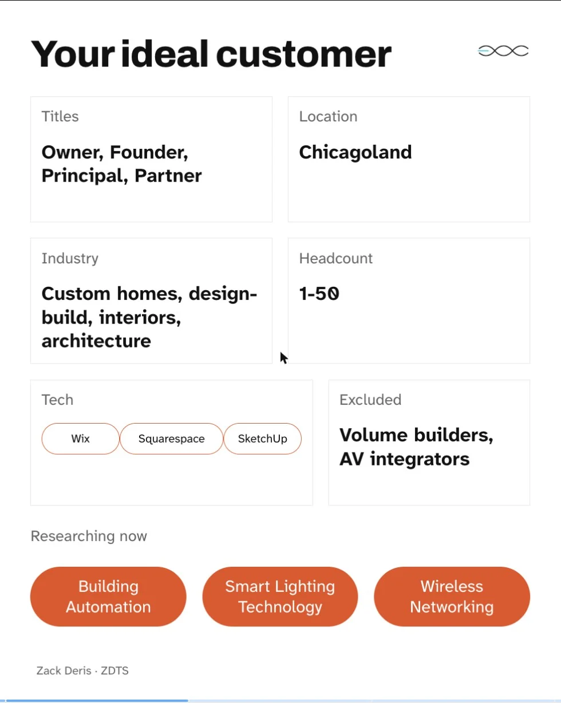
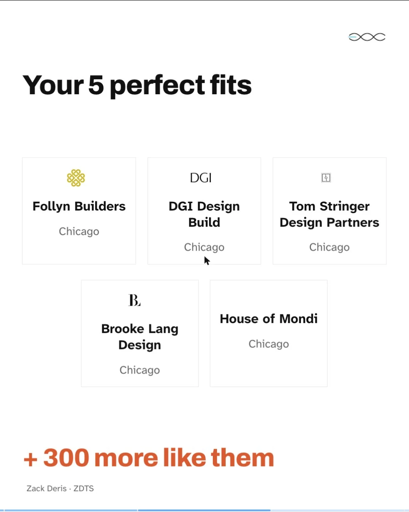
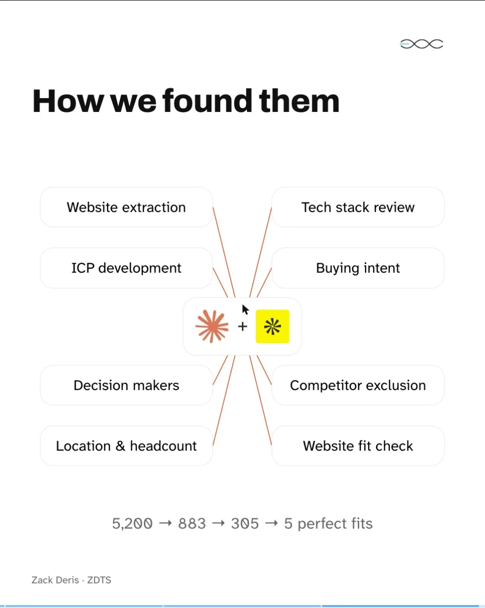
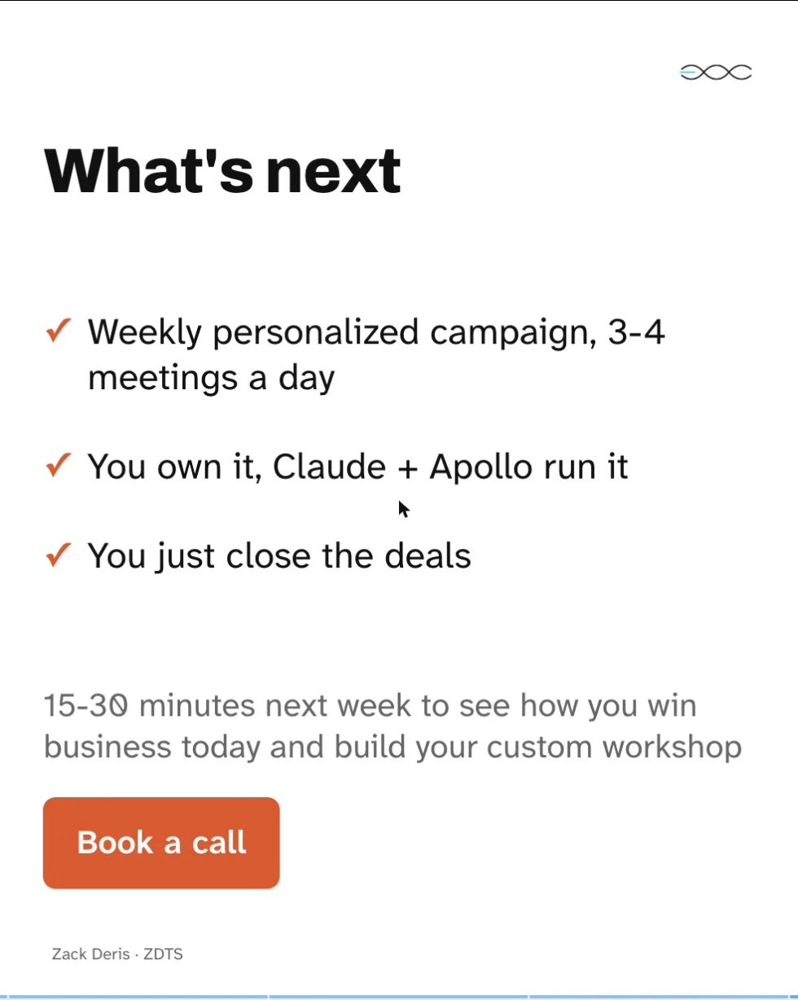

<p align="center">
  
</p>

<p align="center">
  <a href="../../releases/latest"></a>
  
  
</p>

<p align="center">
  <a href="https://zackderis.com/gtmai"><b>Website</b></a> ·
  <a href="https://zackderis.notion.site/gtm"><b>Step-by-step guide</b></a> ·
  <a href="docs/how-it-works.md"><b>How it works</b></a> ·
  <a href="../../releases/latest"><b>Download</b></a>
</p>

**GTMAI is a free AI skill that runs your outbound campaign inside your AI assistant.** It finds companies that look like your best clients, picks the top 5, finds verified decision-makers, builds a personalised Gamma deck for each one and loads a ready-to-launch Apollo sequence. After each sales call, it turns the Fireflies recording into a closing deck and email.

You approve every step, and nothing sends until you press Activate.

You don't need 20,000 leads you'll never prospect. You need 50 to 100 qualified, in-market leads who are ready to be pitched.

## Contents

- [The results](#the-results)
- [How it works](#how-it-works)
- [What the prospect receives](#what-the-prospect-receives)
- [Quick start](#quick-start)
- [What you need](#what-you-need)
- [What it does and doesn't do on its own](#what-it-does-and-doesnt-do-on-its-own)
- [FAQ](#faq)
- [What's in this repo](#whats-in-this-repo)
- [About](#about)

## The results

One campaign, 26 October to 2 November 2026: 127 leads identified, 20 conversations, 11 proposals, 6 deals closed.

<p align="center">
  
</p>

These are Zack's own numbers, from selling ZDTS services. Your results depend on your offer, market and follow-up.

## How it works



| Stage | What GTMAI does | What you do |
|---|---|---|
| **Your brief** | Learns what you sell, who to and your best proof | Upload a brief, answer 8 questions, or point it at your website |
| **Connect** | Runs a setup check and reads your Apollo Context Center | Connect the 3 tools and confirm your ICP |
| **Search** | Builds a look-alike search from your best clients | Approve the filters and save the list |
| **Top 5** | Researches every company, removes bad fits, scores the best out of 100 with sources | Approve your 5 |
| **Contacts** | Finds up to 2 decision-makers per company, verified emails only | Approve titles and enrichment |
| **Decks** | Researches each prospect's market and builds a personalised Gamma deck | Approve the research and each deck |
| **Sequence** | Writes each lead their own 2 emails and builds a 4-step sequence, switched off | Review it and press Activate |
| **Close** | Reads the Fireflies call and builds a closing deck and follow-up email | Review and send |

Plan on 45 to 90 minutes for your first full run. **[See every stage with screenshots →](docs/how-it-works.md)**

## What the prospect receives

Every deck is a free sample of your work, done on that prospect. It shows their own market, their ideal customers and 5 companies they should talk to this week.

<p align="center">
  
  
  
  
  
</p>

The deck recipe adapts to what you sell. [`proof-of-work.md`](gtmai/references/proof-of-work.md) has recipes for many service types, plus a method for anything else.

The sequence then delivers it in 4 steps:

1. **LinkedIn connect:** you send a short personal note GTMAI writes for each lead
2. **LinkedIn engage:** you like their latest post and leave a useful comment
3. **Email 1:** goes out automatically and names their 5 perfect-fit companies
4. **Email 2:** four hours later in the same thread, if they haven't replied, with their numbers and their deck

## Quick start

Download the zip for your AI from the [latest release](../../releases/latest).

| AI | File | Install guide | Status |
|---|---|---|---|
| **Claude** (recommended) | `gtmai.zip` | [Below](#claude) | Tested live |
| ChatGPT | `gtmai-chatgpt.zip` | [Guide](platforms/install/chatgpt.md) | Tested live |
| Gemini | `gtmai-gemini.zip` | [Guide](platforms/install/gemini.md) | Tested live |
| Grok | `gtmai-grok.zip` | [Guide](platforms/install/grok.md) | Tested live |
| Microsoft 365 Copilot | `gtmai-copilot.zip` | [Guide](platforms/install/copilot.md) | Built to Microsoft's spec; work or school accounts only |

### Claude

1. Open [claude.ai](https://claude.ai) and click **Customize** in the left sidebar.
2. On the **Skills** tab, click **Add**, then **Upload skill**.
3. Drop in `gtmai.zip`, click **Upload** and make sure it's switched on.
4. Go to **Customize → Connectors** and connect **Apollo.io**, **Gamma** and **Fireflies**.
5. Open a new chat and type `/gtmai`.

GTMAI takes it from there. If you want every click with a screenshot, use the [step-by-step guide](https://zackderis.notion.site/gtm).

## What you need

| Need | Details |
|---|---|
| **An AI plan** | Claude: Pro, Max, Team or Enterprise. ChatGPT: any paid plan. Gemini: a personal Google account. Grok: SuperGrok or X Premium+ works best. Copilot: a Microsoft 365 Copilot licence. |
| **[Apollo](https://get.apollo.io/zack)** | Finds companies and verified contacts, and runs the sequence. Connect your mailbox so emails can send. |
| **[Gamma](https://gamma.app/?utm_campaign=prompt&utm_content=Zack+Deris&utm_source=LinkedIn)** | Builds the decks. Each deck uses roughly 100-150 Gamma credits, so a paid plan covers a full campaign. |
| **[Fireflies](https://fireflies.ai/?fpr=zdts)** | Records your sales calls for the closing deck. |

If a tool won't connect, GTMAI switches to [manual mode](platforms/manual-mode.md): it writes the exact filters, deck prompt and emails, and you do the clicks in that tool's own website.

## What it does and doesn't do on its own

Built in as rules, not settings:

- **Sequences are always created switched off.** Nothing sends until you activate it.
- **It asks before spending credits or enrolling anyone**, and tells you what will happen first.
- **It doesn't invent facts.** Prospect claims come from Apollo, your brief or linked sources, and estimates are labelled.
- **Verified emails only.** Risky mailboxes are dropped or flagged for your decision.
- **No API keys in chat.** Every tool connects through your AI's own sign-in.
- **One stage at a time.** It stops and waits for your reply.

As with any outreach, you're responsible for what you send and for following the email, privacy and platform rules that apply to you.

## FAQ

<details><summary><b>Is it really free?</b></summary>

Yes. You pay only for the tools you use: your AI plan, and any Apollo or Gamma credits the campaign spends.
</details>

<details><summary><b>Will it send emails without my permission?</b></summary>

No. Leads are enrolled only after you say yes, and nothing sends until you activate the sequence yourself.
</details>

<details><summary><b>Can I write the emails myself?</b></summary>

Yes. GTMAI asks whether you want help or would rather write them. Either way, each lead gets their own copy with their real name, company and deck link.
</details>

<details><summary><b>What if the chat stops partway through?</b></summary>

GTMAI keeps a campaign card as it goes. Paste it into a new chat after `/gtmai continue` and it picks up where you left off.
</details>

<details><summary><b>Why is Claude recommended?</b></summary>

GTMAI started as a Claude skill and Claude is still the source version. The other versions are built from it and use written numbered options instead of Claude's answer buttons.
</details>

<details><summary><b>Can I use it for my clients?</b></summary>

Yes. You can use and edit it for your own business and for clients you serve. You can't resell or redistribute it. See the [license](LICENSE).
</details>

<details><summary><b>I found a bug. Where do I report it?</b></summary>

[Open an issue](../../issues) with the stage you were on and which AI you were using. Please leave out any API keys or prospect data.
</details>

## What's in this repo

```
gtmai/                 The Claude skill: the source of truth
  SKILL.md             Rules and all 10 stages
  references/          Apollo, Gamma, sequence, ranking and deck-recipe guides
platforms/
  build.py             Builds every other AI's version from gtmai/
  platforms.py         Per-AI rewrites (tool setup, buttons, names)
  core-skill.md        The lean SKILL.md used on other AIs
  manual-mode.md       Fallback when a tool isn't connected
  install/             Install guide for each AI
docs/                  Stage-by-stage guide and images
```

To build it yourself, edit `gtmai/`, then run:

```bash
python3 platforms/build.py
```

The zips, install guides and all-in-one files land in `dist/`. Run `python3 platforms/build.py chatgpt` to build one version. See the [changelog](CHANGELOG.md) for what's new.

## About

Built by **[Zack Deris](https://zackderis.com)**, AI Sales Systems Consultant. In sales since 2009, now building AI-powered outbound systems for B2B founders and teams.

**Want it built for your team?** [Book a call](https://zackderis.com/book-a-call).

[LinkedIn](https://www.linkedin.com/in/zdnft) · [YouTube](https://www.youtube.com/@zackderis) · [X](https://x.com/zackydzz)

Free for your own business and your clients, not for resale or redistribution. See [LICENSE](LICENSE). The Apollo, Gamma and Fireflies links above are partner links, so Zack may earn a commission or credit if you sign up through them, at no cost to you. GTMAI isn't affiliated with or endorsed by Anthropic, OpenAI, Google, xAI or Microsoft.
