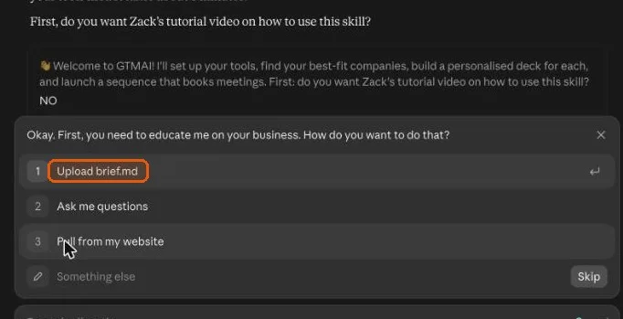
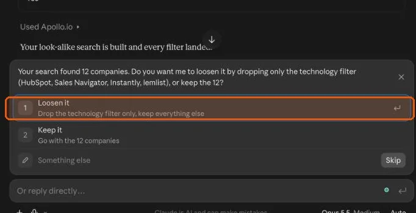
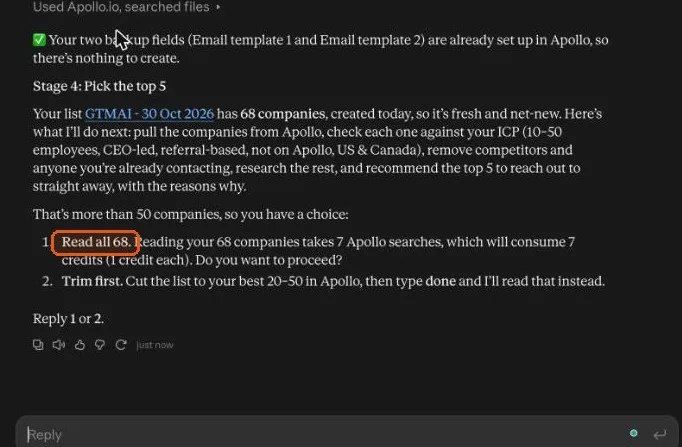
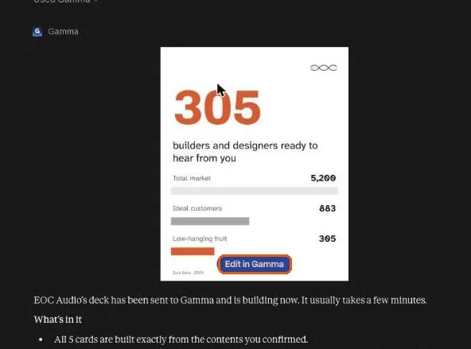
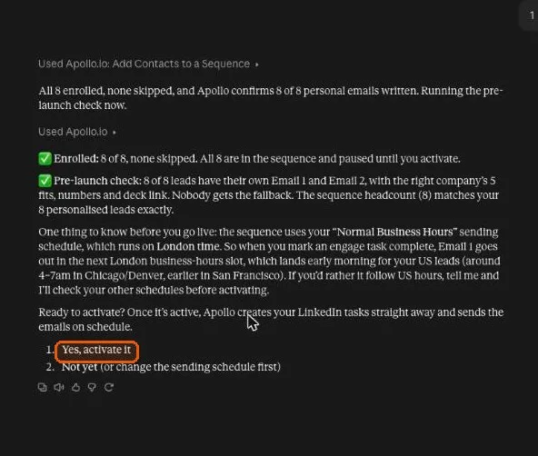

# How GTMAI works

GTMAI runs one stage at a time. Each stage ends with one clear question, and it waits for your answer. The screenshots are from a live run in Claude; every AI follows the same stages.

For every click from install to launch, use the [full step-by-step guide](https://zackderis.notion.site/gtm).

## 1. Install (2 minutes)

Upload GTMAI to your AI assistant once. See the [install steps](../README.md#quick-start).

## 2. Teach it your business (5 minutes)

GTMAI learns what you sell, who you sell to and your best proof, so every search, deck and email is about your business.

**You:** type `/gtmai`, then upload a brief, answer 8 quick questions or let it read your website. Confirm your look-alike clients, locations and first name.

**GTMAI:** plays back what you sell in 3 lines and turns your last 5 clients into look-alike seeds.

## 3. Connect your tools (5 minutes)

**You:** follow the sign-up and connect links for Apollo, Gamma and Fireflies, then confirm your ICP checklist.

**GTMAI:** runs a 5-point setup check, then reads your Apollo AI Context Center and merges it with your brief. Nothing is searched until you confirm.

## 4. Find best-fit companies (10 minutes)

**You:** pick a look-alike or full ICP search, approve the technology and buying-intent filters, then save the search and add the companies to a list in Apollo.

**GTMAI:** confirms your client records in Apollo, checks the count, loosens only the tech filter if the list is too small, and gives you a link with every filter already set.

## 5. Pick your top 5 (10 minutes)

**You:** approve reading the list, review the top picks and runners-up, then approve your 5.

**GTMAI:** researches companies in batches, removes competitors, existing clients and poor fits, and scores each pick out of 100 with a "why them, why now" and sources.

## 6. Find verified decision-makers (5 minutes)

**You:** name your leads list, approve the job titles and approve enrichment.

**GTMAI:** finds up to 2 decision-makers per company, keeps verified emails only, flags anything that needs your call, saves the leads and reads the list back to confirm.

## 7. Build a Gamma deck for each company (5-10 minutes each)

**You:** approve the deck recipe once, approve each company's research and five perfect fits, then say go.

**GTMAI:** researches each prospect's market (total market, ideal customers, easiest wins), builds the deck in Gamma, checks it card by card and fixes anything that's off.

## 8. Build the Apollo sequence (10 minutes)

**You:** confirm your booking link and sending mailbox, review both emails, then approve creating the sequence and enrolling your leads.

**GTMAI:** writes each lead's own two emails with no merge tags, creates the 4-step sequence switched off, and runs a pre-launch check on every lead.

## 9. Turn every call into a closing deck

**You:** take the call with Fireflies recording, then type `/gtmai continue` with your campaign card. Review the closing deck and email, then send.

**GTMAI:** reads the transcript from Fireflies, builds a closing deck around what they said and writes the follow-up email with the deck link.

## Going deeper

- [`gtmai/SKILL.md`](../gtmai/SKILL.md): the full rules and stage instructions
- [`gtmai/references/`](../gtmai/references): the Apollo, Gamma, sequence and ranking guides
- [`platforms/manual-mode.md`](../platforms/manual-mode.md): what happens when a tool won't connect
